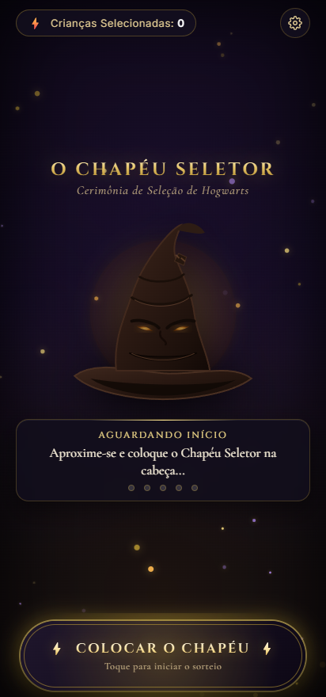
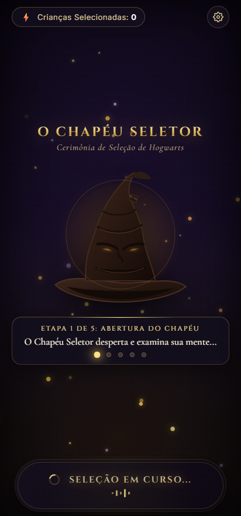
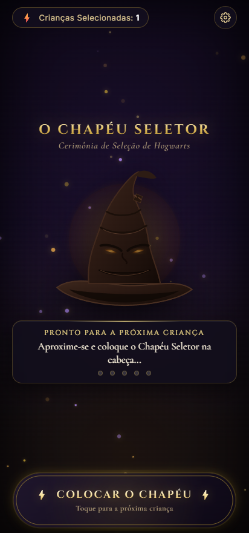
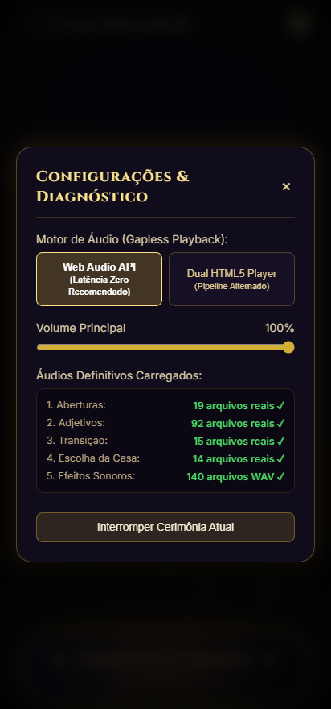
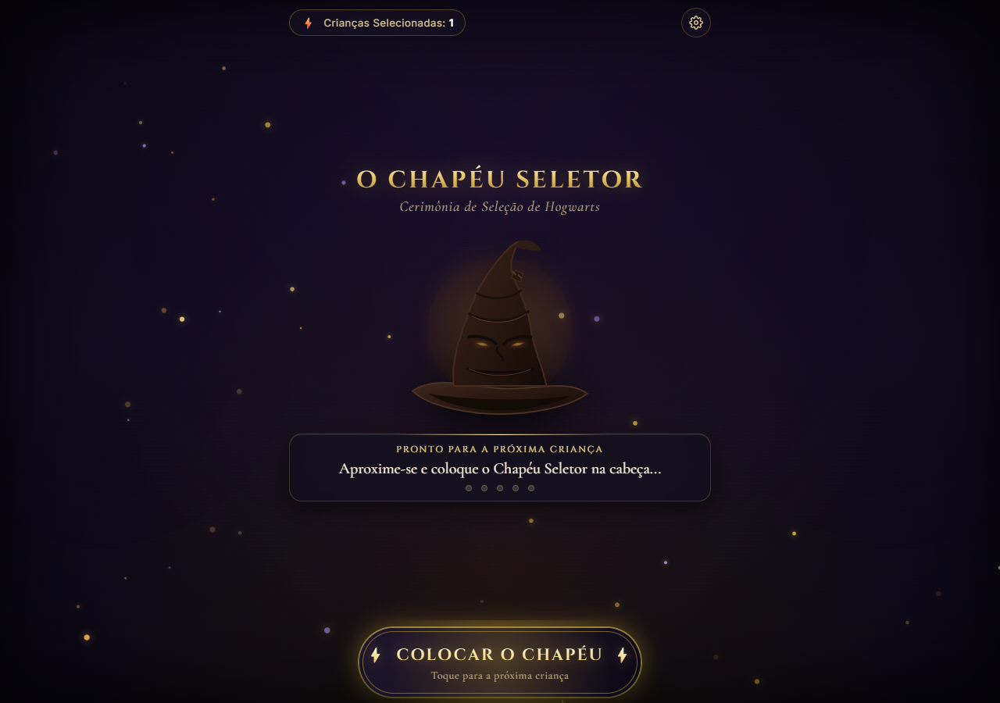

# 🧙‍♂️ O Chapéu Seletor (Cerimônia de Hogwarts)

[](https://deepmind.google/technologies/gemini/)
[](https://www.typescriptlang.org/)
[](https://vitejs.dev/)
[](https://developer.mozilla.org/en-US/docs/Web/API/Web_Audio_API)
[](https://flutter.dev/)

Uma aplicação móvel interativa e imersiva desenvolvida especialmente para **aniversários infantis temáticos de Harry Potter**. O ritual funciona na vida real: a criança coloca o **Chapéu Seletor físico na cabeça**, o operador clica no botão pelo **smartphone** (conectado via Bluetooth a uma caixa de som oculta ou embutida no ambiente) e a magia acontece — o chapéu ganha vida, analisa a mente da criança com voz imponente e proclama a casa de Hogwarts com confetes e animações em tempo real!

> ⚡ **Vibe Coded com Gemini 3.8 Flash**: Todo este projeto — desde a concepção do motor de áudio com zero latência, a interface mística com partículas mágicas e renderização procedural SVG do chapéu, até a versão nativa em Flutter — foi criado no fluxo de **vibe coding** impulsionado pela inteligência artificial do **Gemini 3.8 Flash**.

---

## 📸 Demonstração Visual (Screenshots)

<div align="center">
  <table>
    <tr>
      <td align="center"><b>1. Tela Inicial (Aguardando a Criança)</b></td>
      <td align="center"><b>2. Ritual em Andamento (Seleção Ativa)</b></td>
    </tr>
    <tr>
      <td></td>
      <td></td>
    </tr>
    <tr>
      <td align="center"><b>3. Proclamação da Casa & Confetes</b></td>
      <td align="center"><b>4. Diagnóstico de Áudio & Configurações</b></td>
    </tr>
    <tr>
      <td></td>
      <td></td>
    </tr>
  </table>

  <br>

  <b>5. Visualização Desktop & Tablets:</b>
  <br><br>
  
</div>

---

## 🎯 O Caso de Uso no Aniversário

### A Dinâmica da Festa
1. **O Cenário**: A criança senta no banquinho e coloca o Chapéu Seletor de feltro/couro na cabeça.
2. **O Operador Secreto**: O pai, mãe ou animador da festa segura o celular conectado por **Bluetooth** a uma caixa de som (escondida atrás do banquinho ou dentro do próprio chapéu).
3. **O Toque Mágico**: Ao tocar no grande botão **"Colocar o Chapéu"**, a aplicação assume o controle:
   - Mantém a tela ligada continuamente (**Screen WakeLock API** impede que o celular bloqueie).
   - Bloqueia toques acidentais até o fim da cerimônia.
   - Sorteia uma combinação única de frases com **transições imperceptíveis (0 ms de gap)**.
   - A boca e os olhos do chapéu na tela se movem sincronizados com as frequências sonoras da voz.
   - No anúncio da Casa (Grifinória, Sonserina, Corvinal ou Lufa-Lufa), confetes mágicos explodem na tela com as cores da casa vencedora.
   - O contador de crianças selecionadas é atualizado automaticamente e o botão volta suavemente para a próxima criança da fila.

---

## ✨ Principais Funcionalidades

- **📱 Experiência Mobile-First Ultra-Limpa**: Pensada para ser operada com uma mão em ambiente de festa, sem scroll e sem distrações.
- **⚡ Motor de Áudio Gapless (Zero Latência)**:
  - Carregamento e decodificação na memória RAM usando a **Web Audio API** (`AudioContext` e `AudioBufferSourceNode`).
  - Sem pausas ou estalos entre o final de uma fala e o começo da próxima.
  - Alternativa embutida com **Dual HTML5 Audio Player** para dispositivos com restrições de memória.
- **🎭 Animação Facial Reativa ao Áudio**:
  - `AnalyserNode` processa os harmônicos da voz em tempo real (FFT).
  - A boca do Chapéu se expande e contrai em sincronia com os fonemas e entonação.
- **🔒 Screen Wake Lock API**: Evita que o celular apague ou trave no meio da fila de crianças.
- **📳 Feedback Háptico**: Vibrações táteis no aparelho a cada virada de frase e ao revelar a casa.
- **🎉 Sistema de Confetes Dinâmico**: Chuva mágica de partículas com as cores oficiais de Hogwarts (Dourado, Escarlate, Esmeralda e Safira).
- **⚙️ Painel de Diagnóstico Integrado**: Modal para testar o volume mestre, verificar os 140 arquivos de áudio carregados e cancelar uma seleção se necessário.
- **📱 Código Nativo Flutter Incluso**: Uma versão 100% nativa pronta para compilar em Android/iOS na pasta `flutter_reference/`.

---

## 🎵 Estrutura do Ritual & Catálogo de Áudios

A cerimônia completa de cada criança é composta por **5 faixas sequenciais concatenadas**:

```
[ 1. Abertura ]  ➜  [ 2. Adjetivo 1 ]  ➜  [ 3. Adjetivo 2 ]  ➜  [ 4. Transição ]  ➜  [ 5. Escolha da Casa ]
   (1 de 15)           (1 de 90)           (1 de 90 distinto)       (1 de 15)               (1 de 20)
```

| Etapa | Quantidade | Descrição | Exemplo de Frase |
| :--- | :---: | :--- | :--- |
| **1. Aberturas** | 15 áudios | O Chapéu acorda e inicia a análise mental | *"Ora, ora... vejamos o que temos aqui..."* |
| **2. Adjetivo 1** | 90 áudios | Primeira característica marcante da criança | *"Vejo uma coragem indomável e um coração leal..."* |
| **3. Adjetivo 2** | 90 áudios | Segunda característica complementar | *"E uma mente astuta pronta para grandes desafios..."* |
| **4. Transição** | 15 áudios | Suspense e preparação para a proclamação | *"Sim... sem dúvidas... seu destino só pode ser..."* |
| **5. Escolha** | 20 áudios | Proclamação triunfante da Casa | *"GRIFINÓRIA!"* / *"SONSERINA!"* |

> 💡 **Nota sobre os Áudios**: O repositório inclui o utilitário `scripts/generate_sample_wavs.js` que gera 140 arquivos WAV sintetizados para testes imediatos. Para utilizar vozes gravadas personalizadas, basta substituir os arquivos na pasta `public/assets/`.

---

## 🛠️ Tecnologias Utilizadas

- **Frontend Core**: TypeScript, HTML5 Semântico, CSS3 Moderno (Glassmorphism, Variáveis CSS, Animações Rúnicas).
- **Web Audio API**: `AudioContext`, `AudioBuffer`, `GainNode`, `AnalyserNode` para streaming de baixa latência e visualizer reativo.
- **Bundler & Dev Server**: [Vite](https://vitejs.dev/) v8.
- **Efeitos de Partículas**: `canvas-confetti` e sistema de partículas canvas próprio em tempo real.
- **Mobile APIs**: `navigator.wakeLock` (WakeLock API) e `navigator.vibrate` (Vibration API).
- **Mobile Nativo**: Flutter & Dart (`just_audio`, `wakelock_plus`) em `flutter_reference/`.

---

## 🚀 Como Executar Localmente

### Pré-requisitos
- [Node.js](https://nodejs.org/) (versão 18 ou superior)
- Navegador moderno (Chrome, Edge, Safari ou Firefox)

### Passo a Passo

1. **Clone o repositório:**
   ```bash
   git clone https://github.com/PauloBTX/ChapeuSeletor.git
   cd ChapeuSeletor
   ```

2. **Instale as dependências:**
   ```bash
   npm install
   ```

3. **Inicie o servidor de desenvolvimento:**
   ```bash
   npm run dev
   ```

4. **Acesse no celular ou computador:**
   - No computador: [http://localhost:5173](http://localhost:5173)
   - No celular (mesma rede Wi-Fi): use o endereço de IP exibido no terminal (exemplo: `http://192.168.1.X:5173`).

---

## 📦 Scripts Disponíveis

| Comando | Descrição |
| :--- | :--- |
| `npm run dev` | Inicia o servidor local do Vite com Hot Module Replacement (HMR). |
| `npm run build` | Compila o TypeScript e empacota o código de produção otimizado para a pasta `dist/`. |
| `npm run preview` | Visualiza localmente o bundle de produção gerado. |
| `node scripts/generate_sample_wavs.js` | Gera os 140 arquivos de áudio WAV sintéticos na pasta `public/assets/`. |
| `node scripts/generate_manifest.js` | Atualiza o arquivo `src/audio/manifest.json` com o catálogo de áudios. |

---

## 📱 Versão Nativa Flutter (`flutter_reference/`)

Para quem prefere compilar um aplicativo nativo para Android ou iOS (APK ou IPA), foi desenvolvida uma versão completa com Flutter:

- Arquivo principal: [`flutter_reference/lib/main.dart`](flutter_reference/lib/main.dart)
- Utiliza a biblioteca `just_audio` com `ConcatenatingAudioSource` para garantir reprodução contínua sem engasgos mesmo em segundo plano.
- Suporte a `WakelockPlus` e vibração tátil nativa.

---

## 🧠 Créditos & Vibe Coding

Este projeto é um exemplo prático de **Vibe Coding** utilizando o modelo **Gemini 3.8 Flash**, unindo agilidade de desenvolvimento, inteligência artificial, engenharia de áudio para navegadores e a magia do universo de Hogwarts para alegrar o aniversário de uma criança! 🧙‍♂️✨

Desenvolvido com carinho por **PauloBTX**.
